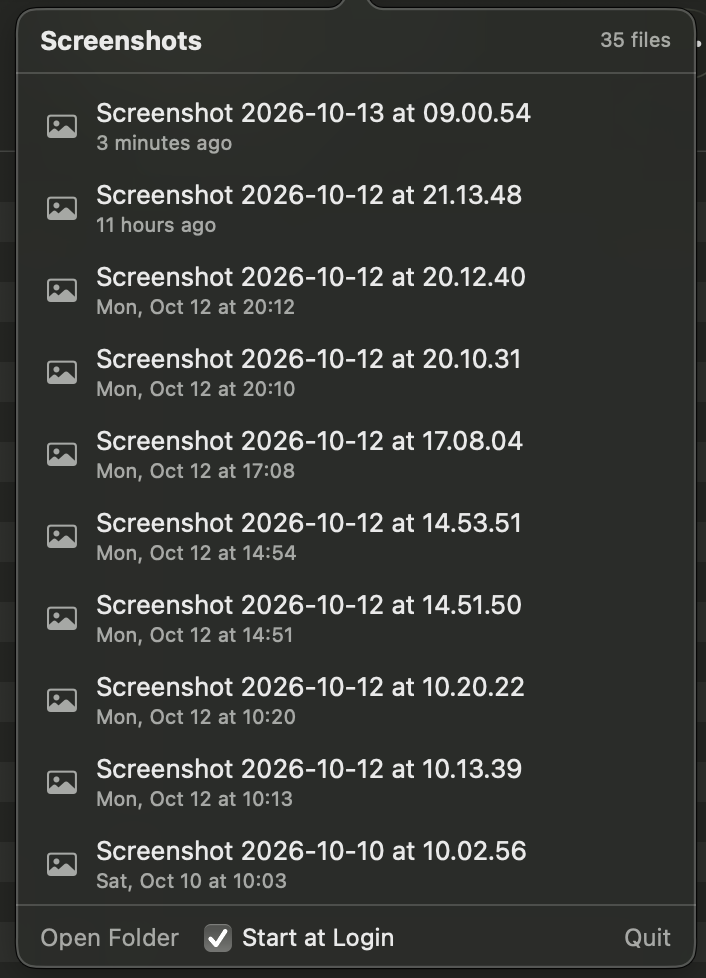

# ScreenBuddy

A tiny macOS menu bar app for your recent screenshots.



- Click the menu bar icon to see every file in your screenshot folder, newest first
- Hover a row to get a larger preview next to the list
- Click a row to copy it (image + file) to the clipboard
- Drag a row into Finder, Slack, Mail, …
- Open the folder, toggle **Start at Login**, or quit from the footer

The folder is whatever macOS uses for screenshots (Screenshot app → Options → Save to), falling back to the Desktop.

Requires macOS 14 or later.

## Install

1. Download `ScreenBuddy.zip` from the [latest release](https://github.com/adriano-kaiser/screenbuddy/releases/latest) and unzip it.
2. Move `ScreenBuddy.app` to `/Applications` (or `~/Applications`).
3. The app is not notarized, so macOS blocks the first launch. Either allow it under
   **System Settings → Privacy & Security → Open Anyway**, or remove the quarantine flag:

   ```bash
   xattr -dr com.apple.quarantine /Applications/ScreenBuddy.app
   ```

## Build from source

Needs the Xcode Command Line Tools (full Xcode is not required).

```bash
./build.sh            # builds build/ScreenBuddy.app
./build.sh install    # also copies it to ~/Applications and launches it
```

## Releasing

Push a version tag; GitHub Actions builds a universal (Apple Silicon + Intel) app and attaches it to a release.

```bash
git tag v1.0.0 && git push origin v1.0.0
```
